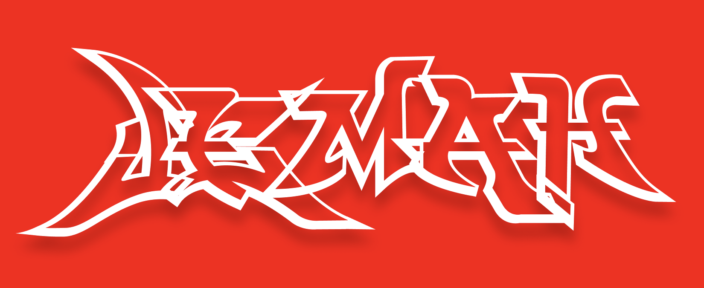

# Our Communist Manifesto
This is a project that aims to translate any grafitti and street art using the power of OCR and computer vision. It is also a place where artists, hobbyists and street art enjoyers gather, discuss and interact with one another under the banner of a truly communal form of art.

Our values reflect the revolutionary and anarchist principles that are the foundations of street and grafitti art. The ideologies of communitarian freedom and hardcore socialism paints who we are, what we do, what our aestheetic language is and what we aim to achieve through creating this community of changemakers.

Of course, ideology isn't everything in art. We are graffiti nerds at heart. We understand that the salivating typography that plays as the foundation of grafitti follows an intense pattern and history that simply cannot be ignored. We understand this and we want people's voices to be heard in this respect.
